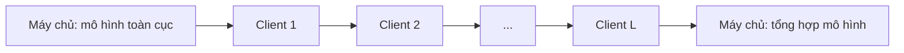

# 🎬 Hệ thống gợi ý phim bảo vệ quyền riêng tư bằng Federated Learning

> **Báo cáo cuối kỳ – Môn Cơ sở hệ thống thông tin**  
> Tái hiện thực nghiệm **FedAvg**, **FedQ** và nén mô hình bằng **NNCodec**.


**Nhóm thực hiện**
- Khương Tuấn Anh – 24022606
- Nguyễn Tuấn Anh – 24022610

**Bài báo gốc:** D. Neumann, A. Lutz, K. Müller, W. Samek, *A Privacy Preserving System for Movie Recommendations Using Federated Learning*, ACM Transactions on Recommender Systems, 3(2), Article 14, 2024.  
[DOI: 10.1145/3634686](https://doi.org/10.1145/3634686)

---

## 📑 Mục lục

- [1. Tổng quan dự án](#1-tổng-quan-dự-án)
- [2. Phạm vi tái hiện](#2-phạm-vi-tái-hiện)
- [3. Dữ liệu](#3-dữ-liệu)
- [4. Cấu trúc repository](#4-cấu-trúc-repository)
- [5. Cài đặt môi trường](#5-cài-đặt-môi-trường)
- [6. Chuẩn bị dữ liệu](#6-chuẩn-bị-dữ-liệu)
- [7. Cách chạy chương trình](#7-cách-chạy-chương-trình)
- [8. Kịch bản thực nghiệm](#8-kịch-bản-thực-nghiệm)
- [9. Kết quả và đánh giá](#9-kết-quả-và-đánh-giá)
- [10. Hạn chế](#10-hạn-chế)
- [11. Phân công](#11-phân-công)
- [12. Tài liệu tham khảo](#12-tài-liệu-tham-khảo)

---

## 1. Tổng quan dự án

Các hệ thống gợi ý phim thường cần thu thập lịch sử và dữ liệu cá nhân của người dùng. Bài báo gốc đề xuất sử dụng **Federated Learning (FL)** để huấn luyện hệ thống gợi ý mà không cần tập trung dữ liệu người dùng tại máy chủ: dữ liệu được giữ ở phía client, còn các tham số mô hình được trao đổi trong quá trình huấn luyện.

Nhóm tái hiện ba thành phần kỹ thuật:

| Thành phần | Vai trò |
|---|---|
| **FedAvg (Algorithm 1)** | Thuật toán FL cơ sở dùng làm đối chứng. Máy chủ tổng hợp các mô hình client bằng trung bình có trọng số. |
| **FedQ (Algorithm 2)** | Tổ chức client thành các hàng đợi. Client sau nhận mô hình từ client trước và tiếp tục huấn luyện; client cuối hàng đợi gửi mô hình lên máy chủ. Phương pháp hướng đến giảm nhiễu khi mỗi client có ít dữ liệu và dữ liệu non-IID. |
| **NNCodec / DeepCABAC** | Lượng tử hóa và mã hóa mô hình trước khi truyền nhằm giảm dung lượng truyền tải. |

### Luồng hoạt động khái quát của FedQ



FedQ sử dụng hàng đợi có độ dài `L`. Khi `L = 1`, FedQ trở thành FedAvg.

Trong phạm vi dự án, nhóm tập trung vào **candidate generator**: dự đoán phim tiếp theo của người dùng dựa trên lịch sử xem, với tối đa 7 phim trong lịch sử đầu vào.

## 2. Phạm vi tái hiện

### 2.1. Thành phần sử dụng từ tác giả

Thư viện nén **NNCodec** được lấy từ repository chính thức của Fraunhofer HHI và giữ nguyên, không chỉnh sửa:

- Repository: https://github.com/fraunhoferhhi/nncodec
- Các thành phần liên quan: `nnc/`, `nnc_core/`, `framework/`, `setup.py`, ...

### 2.2. Thành phần do nhóm triển khai

Các thành phần sau do nhóm tự cài đặt dựa trên mô tả trong bài báo:

- `data.py`: tiền xử lý dữ liệu MovieLens và tạo dữ liệu cho từng client.
- `model.py`: candidate generator và hàm tính Top-100 accuracy.
- `fl.py`: FedAvg, FedQ và hàm tích hợp NNCodec.
- `run_experiment.py`: chạy các kịch bản central, FedAvg và FedQ.
- `plot_results.py`: tổng hợp kết quả và vẽ biểu đồ.

Theo tài liệu nhóm sử dụng, mã triển khai FedQ, mô phỏng FL và mô hình trong bài báo không được công bố kèm bài báo gốc.

## 3. Dữ liệu

Dự án sử dụng bộ dữ liệu **MovieLens ml-latest-small** do GroupLens cung cấp.

- Trang dữ liệu: https://grouplens.org/datasets/movielens/
- Phiên bản nhóm sử dụng: `ml-latest-small`
- File cần dùng: `ratings.csv`

Dữ liệu không được lưu sẵn trong repository. Người dùng cần tự tải và giải nén bộ dữ liệu.

### 3.1. So sánh dữ liệu

| Thông tin | Bài báo | Nhóm |
|---|---:|---:|
| Phiên bản | MovieLens 25M | ml-latest-small |
| Số rating | 25.000.095 | 100.836 |
| Số người dùng | 162.541 | 610 |
| Số phim | 59.047 | 9.724 |

Nhóm sử dụng phiên bản nhỏ hơn do giới hạn phần cứng.

### 3.2. Tiền xử lý

Quy trình tiền xử lý được thực hiện trong `data.py`:

1. Sắp xếp rating của từng người dùng theo `timestamp`.
2. Tạo mẫu bằng cửa sổ trượt kích thước 7: lịch sử tối đa 7 phim được dùng để dự đoán phim tiếp theo.
3. Mỗi người dùng được xem là một client trong Federated Learning.
4. 10% mẫu cuối cùng theo thời gian của mỗi người dùng được dùng làm tập kiểm tra.
5. Chỉ số đánh giá là **Top-100 accuracy**: phim thực tế tiếp theo có nằm trong 100 phim được mô hình chấm điểm cao nhất hay không.

### 3.3. Thống kê dữ liệu sau tiền xử lý

| Cấu hình | Số client | Số phim | Mẫu train | Mẫu test |
|---|---:|---:|---:|---:|
| Toàn bộ `ml-latest-small` | 610 | 9.724 | 90.478 | 9.748 |
| `--max_users 300` | 300 | 6.645 | 37.584 | 4.027 |

## 4. Cấu trúc repository

Cấu trúc thư mục dự kiến:

```text
.
├── data.py                 # Tiền xử lý MovieLens, tạo dữ liệu client
├── model.py                # Candidate generator và Top-k accuracy
├── fl.py                   # FedAvg, FedQ và tích hợp NNCodec
├── run_experiment.py       # Chạy thực nghiệm central / fedavg / fedq
├── plot_results.py         # Vẽ biểu đồ và tổng hợp kết quả
├── results/                # Các file CSV kết quả
├── anh/                    # Hình ảnh kết quả dùng trong báo cáo
├── nnc/                    # Mã nguồn NNCodec
├── nnc_core/
├── framework/
├── setup.py
└── README.md
```

> Lưu ý: Cấu trúc trên phản ánh các thành phần được mô tả trong báo cáo. Tên hoặc thư mục thực tế có thể khác tùy theo repository nhóm đang sử dụng.

## 5. Cài đặt môi trường

### 5.1. Yêu cầu

- Python 3.10 (khuyến nghị)
- PyTorch
- NumPy
- pandas
- matplotlib
- TensorFlow và công cụ biên dịch C++ khi sử dụng phần nén NNCodec

### 5.2. Tạo môi trường và cài thư viện

```bash
conda create -n fedrec python=3.10 -y
conda activate fedrec

pip install torch numpy pandas matplotlib wheel pybind11 tensorflow scikit-learn tqdm h5py click opencv-python
```

### 5.3. Cài đặt NNCodec

Thực hiện tại thư mục gốc repository, nơi có file `setup.py`:

```bash
pip install .
```

Kiểm tra cài đặt:

```bash
python -c "import nnc; print('NNCodec OK')"
```

**Lưu ý trên Windows:** Một số máy bật Smart App Control có thể chặn file `.dll` hoặc `.pyd` của pandas/TensorFlow và báo lỗi `Application Control policy has blocked this file`. Theo quá trình thực nghiệm của nhóm, phần nén được chạy trên Google Colab trong trường hợp này.

## 6. Chuẩn bị dữ liệu

1. Tải bộ dữ liệu `ml-latest-small` từ [GroupLens](https://grouplens.org/datasets/movielens/).
2. Giải nén dữ liệu.
3. Xác định đường dẫn thư mục chứa file `ratings.csv`.
4. Dùng đường dẫn thư mục đó làm giá trị cho tham số `--data_dir`.

Ví dụ, nếu `ratings.csv` nằm trong thư mục `ml-latest-small`, có thể chạy lệnh với:

```bash
python run_experiment.py --data_dir ./ml-latest-small --mode central --rounds 20 --lr 0.001
```

Thay `./ml-latest-small` bằng đường dẫn thực tế trên máy của bạn.

## 7. Cách chạy chương trình

Các lệnh dưới đây được chạy tại thư mục gốc repository.

### A. Baseline không sử dụng Federated Learning

```bash
python run_experiment.py --data_dir DATA --mode central --rounds 20 --lr 0.001
```

### B. FedAvg

```bash
python run_experiment.py --data_dir DATA --mode fedavg --rounds 50 --clients_per_round 100 --lr 0.05
```

### C. FedQ với hàng đợi `L = 10`

```bash
python run_experiment.py --data_dir DATA --mode fedq --rounds 50 --clients_per_round 100 --queue 10 --lr 0.05
```

### D. FedQ với hàng đợi `L = 50`

```bash
python run_experiment.py --data_dir DATA --mode fedq --rounds 50 --clients_per_round 100 --queue 50 --lr 0.05
```

### E. FedQ kết hợp nén NNCodec

Ví dụ cấu hình `L = 5`, 20 client mỗi round, 5 round và `QP = -30`:

```bash
python run_experiment.py --data_dir DATA --mode fedq --rounds 5 --clients_per_round 20 --queue 5 --lr 0.05 --qp -30
```

Có thể thay đổi giá trị `--qp` để khảo sát các mức nén khác nhau.

### F. Thay đổi số lượng người dùng

FedAvg với tối đa 300 người dùng:

```bash
python run_experiment.py --data_dir DATA --mode fedavg --max_users 300 --rounds 50 --clients_per_round 100 --lr 0.05
```

FedQ với tối đa 300 người dùng:

```bash
python run_experiment.py --data_dir DATA --mode fedq --max_users 300 --rounds 50 --clients_per_round 100 --queue 10 --lr 0.05
```

### G. Vẽ biểu đồ và tổng hợp kết quả

Sau khi chạy các thực nghiệm:

```bash
python plot_results.py
```

### 7.1. Các tham số chính

| Tham số | Ý nghĩa |
|---|---|
| `--mode {central,fedavg,fedq}` | Chế độ huấn luyện |
| `--rounds` | Số round; với `central` được dùng như số epoch |
| `--clients_per_round` | Số client được chọn trong mỗi round (`N`) |
| `--queue` | Độ dài hàng đợi (`L`), chỉ dùng cho FedQ. `N` phải chia hết cho `L` |
| `--epochs` | Số epoch huấn luyện cục bộ (mặc định 1) |
| `--batch_size` | Kích thước batch (mặc định 64) |
| `--lr` | Learning rate |
| `--qp` | Tham số lượng tử hóa NNCodec. Không truyền tham số này nghĩa là không nén |
| `--max_users` | Giới hạn số lượng người dùng được sử dụng |

Mỗi lần chạy tạo một file kết quả có dạng:

```text
results/<mode>_N<N>_L<L>_qp<QP>.csv
```

Các cột trong file CSV:

- `round`: vòng huấn luyện.
- `top100_acc`: Top-100 accuracy.
- `MB_sent`: dung lượng đã truyền sau nén (nếu có).
- `MB_raw`: dung lượng mô hình trước nén.
- `sec`: thời gian thực thi.

**Cảnh báo:** Tên file CSV không chứa số lượng người dùng. Khi chạy lại cùng cấu hình với `--max_users` khác, hãy đổi tên hoặc sao lưu file kết quả cũ để tránh bị ghi đè.

## 8. Kịch bản thực nghiệm

| Kịch bản | Nội dung | Cấu hình của nhóm | Cấu hình bài báo / đối chiếu |
|---|---|---|---|
| A | Baseline không FL | Central, 20 epoch, `lr = 0.001`, 1 lần chạy; code có ghi nhận hệ số nhân 10, momentum 0,9 và batch 256 | Huấn luyện tập trung, 5 lần chạy |
| B | FedAvg | 100 client/round, 50 round, `lr = 0.05`, 610 người dùng | 1.000–162.000 client, 300 round |
| C | FedQ, `L = 10` | 100 client/round, 50 round, 10 hàng đợi mỗi round, `lr = 0.05`, 610 người dùng | Queue 10, 100, 1.000 |
| D | FedQ, `L = 50` | 100 client/round, 50 round, 2 hàng đợi mỗi round, `lr = 0.05`, 610 người dùng | Đối chiếu các độ dài queue trong bài báo |
| E | FedQ + NNCodec | FedQ `L = 5`, 20 client/round, 5 round, `QP = -30` | `QP = -30` cho candidate generator |
| F | Khảo sát QP | `QP ∈ {-38, -30, -20, -10}`, cấu hình như E | QP từ -48 đến 0 |
| G | Thay đổi số người dùng | 300 người dùng, FedAvg và FedQ `L = 10` | 1.000–162.000 client |

### Những điểm khác biệt so với bài báo

- Sử dụng MovieLens phiên bản nhỏ thay vì MovieLens 25M; số client và số round ít hơn đáng kể.
- Nhóm sử dụng SGD như mô tả của tác giả nhưng điều chỉnh learning rate cho bộ dữ liệu nhỏ.
- Các lần chạy nén (E, F) chỉ có 5 round và 20 client mỗi round do thời gian nén trên CPU.
- Nhóm tính dung lượng truyền ở mọi bước chuyển mô hình, bao gồm cả truyền giữa các client trong hàng đợi. Bài báo chỉ tính truyền xuống và truyền lên giữa máy chủ với client. Vì vậy, số MB của nhóm không thể so sánh trực tiếp với số liệu trong bài báo.

## 9. Kết quả và đánh giá

> Các số liệu dưới đây là kết quả được ghi nhận trong báo cáo thực nghiệm của nhóm. Do khác biệt về dữ liệu, quy mô và cách đo, không nên so sánh trực tiếp các giá trị tuyệt đối với bài báo gốc.

### 9.1. So sánh thuật toán

Cấu hình: 610 người dùng, 100 client/round, 50 round, learning rate 0,05.

| Cấu hình | Top-100 cuối (%) | Top-100 sau round 1 (%) | MB truyền sau 50 round |
|---|---:|---:|---:|
| Central (20 epoch) | 8,16 (cao nhất 10,51 ở epoch 11) | 8,31 (epoch 1) | – |
| FedAvg | 7,56 | 1,22 | 153.919,9 |
| FedQ, `L = 10` | 8,12 | 2,39 | 84.655,9 |
| FedQ, `L = 50` | 10,06 | 6,92 | 78.499,1 |

Các cấu hình FedAvg và FedQ ở bảng trên không sử dụng nén, do đó dung lượng gửi bằng dung lượng mô hình gốc.

**Nhận xét:**

- FedQ đạt Top-100 accuracy cao hơn FedAvg trong các lần chạy được ghi nhận: FedAvg đạt 7,56%, FedQ `L = 10` đạt 8,12% và FedQ `L = 50` đạt 10,06%.
- FedQ `L = 50` có kết quả tốt ngay từ round đầu (6,92%), trong khi FedAvg đạt 1,22%.
- Theo cách giải thích trong bài báo, mỗi cập nhật FedQ đi qua dữ liệu của nhiều client nối tiếp nhau nên có thể giảm nhiễu. Với FedAvg, các client có ít mẫu có thể tạo ra những cập nhật khác hướng nhau.
- Baseline central đạt đỉnh 10,51% ở epoch 11 rồi giảm còn 8,16% ở epoch 20, cho thấy dấu hiệu quá khớp trong lần chạy này.
- Chênh lệch giữa FedQ `L = 10` và FedAvg khoảng 0,6 điểm phần trăm. Mỗi cấu hình mới chỉ chạy một lần (một seed), do đó chưa đủ cơ sở để kết luận chắc chắn về mức chênh lệch.
- Theo bài báo (Mục 3.6), mỗi round của FedQ có thể tốn thời gian gấp `L` lần FedAvg do các client trong hàng đợi huấn luyện nối tiếp. Cột `sec` trong CSV ghi thời gian chạy thực tế.

**Lưu ý về băng thông:** FedAvg ghi nhận 153,9 GB, còn FedQ ghi nhận 78,5–84,7 GB. Tuy nhiên, chênh lệch này chủ yếu liên quan đến cách đếm truyền dữ liệu trong code của nhóm: mỗi lần truyền khoảng 15,4 MB; FedAvg có 200 lần truyền mỗi round (100 client, mỗi client một lần nhận và một lần gửi), FedQ `L = 10` có 110 lần và FedQ `L = 50` có 102 lần. Vì vậy, chưa thể kết luận FedQ tiết kiệm băng thông hơn chỉ từ các số liệu này.

### 9.2. Kịch bản G: 300 người dùng

Cấu hình: 6.645 phim, 100 client/round, 50 round, learning rate 0,05.

| Thuật toán | Top-100 cuối (%) | MB truyền |
|---|---:|---:|
| FedAvg | 8,72 | 114.385,5 |
| FedQ, `L = 10` | 8,82 | 62.912,0 |

Với 300 người dùng, FedQ chỉ cao hơn FedAvg 0,1 điểm phần trăm. Chênh lệch này chưa đủ để kết luận. Khi mỗi client có nhiều dữ liệu hơn (ít người dùng hơn trên cùng tập dữ liệu), lợi thế của FedQ giảm; điều này phù hợp với mục tiêu thiết kế của FedQ là xử lý trường hợp client có ít dữ liệu.

### 9.3. Nén NNCodec

Cấu hình: FedQ `L = 5`, 20 client/round, 5 round, 610 người dùng; thực nghiệm chạy trên Google Colab.

| QP | Top-100 (%) | MB gửi sau nén | MB gốc | Tiết kiệm (%) |
|---:|---:|---:|---:|---:|
| -38 | 1,97 | 369,0 | 1.847,0 | 80,02 |
| -30 | 1,06 | 250,6 | 1.847,0 | 86,43 |
| -20 | 0,90 | 133,6 | 1.847,0 | 92,77 |
| -10 | 1,61 | 38,1 | 1.847,0 | 97,94 |

Công thức tính tỷ lệ tiết kiệm:

```text
Tiết kiệm (%) = (1 - MB gửi sau nén / MB gốc) × 100
```

**Nhận xét:**

- Khi QP tăng theo các giá trị khảo sát, mức nén mạnh hơn; tỷ lệ tiết kiệm trong thí nghiệm tăng từ 80,02% lên 97,94%.
- Mức tiết kiệm của nhóm thấp hơn số liệu bài báo được trích trong báo cáo tại một số QP (bài báo: 92,97% ở QP -38 và 95,37% ở QP -30). Một giả thuyết là nhóm chỉ chạy 5 round nên trọng số còn gần giá trị khởi tạo ngẫu nhiên, khiến việc nén kém hiệu quả hơn. Đây là giả thuyết, nhóm chưa kiểm chứng.
- Chưa thể đánh giá chắc chắn ảnh hưởng của QP đến chất lượng mô hình. Thực nghiệm chỉ chạy 5 round; Top-100 accuracy còn gần mức ngẫu nhiên khi chọn 100 trong 9.724 phim (xấp xỉ 1,03%). Vì vậy, kết luận về NNCodec trong báo cáo chủ yếu dựa trên mức tiết kiệm dung lượng truyền.

## 10. Hạn chế

- Sử dụng dữ liệu nhỏ, số round ít và mỗi cấu hình chỉ chạy một lần (một seed). Các giá trị tuyệt đối không thể so sánh trực tiếp với bài báo; kết quả chủ yếu dùng để xem xét xu hướng.
- Các lần chạy nén chỉ có 5 round và 20 client/round nên accuracy còn gần mức ngẫu nhiên. Chưa có lần chạy không nén với cùng cấu hình để làm đối chứng accuracy.
- Cách tính dung lượng truyền khác với bài báo (xem mục [Kịch bản thực nghiệm](#8-kịch-bản-thực-nghiệm)).
- Mô phỏng tuần tự trên một máy; chưa thử nghiệm với số lượng client lớn như bài báo (hàng chục nghìn đến 162.000 client).
- Chỉ tái hiện candidate generator; chưa triển khai ranker, tầng re-ranking và các thí nghiệm trên bộ benchmark LEAF trong phụ lục bài báo.

## 11. Phân công

| Thành viên | MSSV | Phụ trách |
|---|---:|---|
| Khương Tuấn Anh | 24022606 | Thực nghiệm, báo cáo, thuyết trình |
| Nguyễn Tuấn Anh | 24022610 | PowerPoint, kết quả thực nghiệm, thuyết trình |

## 12. Tài liệu tham khảo

1. D. Neumann, A. Lutz, K. Müller, W. Samek. *A Privacy Preserving System for Movie Recommendations Using Federated Learning*. ACM Transactions on Recommender Systems, 3(2), Article 14, 2024. https://doi.org/10.1145/3634686
2. H. B. McMahan, E. Moore, D. Ramage, S. Hampson, B. Agüera y Arcas. *Communication-Efficient Learning of Deep Networks from Decentralized Data*. AISTATS, 2017.
3. F. M. Harper, J. A. Konstan. *The MovieLens Datasets: History and Context*. ACM Transactions on Interactive Intelligent Systems, 2015.
4. Fraunhofer HHI. **NNCodec**. https://github.com/fraunhoferhhi/nncodec

---

## Ghi chú trước khi chạy

- Đảm bảo đã tải MovieLens và truyền đúng đường dẫn thư mục chứa `ratings.csv` vào `--data_dir`.
- Chạy các lệnh tại thư mục gốc của repository.
- Sao lưu các file trong `results/` trước khi chạy lại cùng cấu hình để tránh ghi đè.
- Nếu chỉ chạy FedAvg/FedQ không nén, không cần truyền tham số `--qp`.
